# Arunika IT Inventory — Backend API (`03.-Inventory_BE`)

REST API untuk **Arunika IT Inventory**, prototype IT Inventory Kawasan Berikat: pengelolaan dokumen kepabeanan BC 2.3 sampai BC 4.1, integrasi simulasi CEISA 4.0 (mock host-to-host & INSW), pencatatan kartu stok, dan laporan mutasi barang.

[](https://inventory-ui-rho-ten.vercel.app)
*Pratinjau antarmuka operasional frontend terhubung ke backend API ini.*

| Layanan | URL / Detail |
|---|---|
| **API Live** | [inventory-api.jidanfatahillah2003.workers.dev](https://inventory-api.jidanfatahillah2003.workers.dev) (Cloudflare Workers) |
| **Frontend UI** | [inventory-ui-rho-ten.vercel.app](https://inventory-ui-rho-ten.vercel.app) (Next.js 16) |
| **Database Cloud** | Neon Serverless PostgreSQL (`ap-southeast-1`), database `new_inventory` |
| **Database Lokal** | PostgreSQL `localhost:5432`, database `new_inventory` |
| **Tech Stack** | Hono · Drizzle ORM · PostgreSQL (Neon) · Zod 4 · JWT (HS256) · PBKDF2 (WebCrypto) |

---

## Daftar Isi

1. [Arsitektur Sistem](#1-arsitektur-sistem)
2. [Desain Database: SQL Relasional Murni](#2-desain-database-sql-relasional-murni)
3. [Simulasi CEISA 4.0 & Host-to-Host](#3-simulasi-ceisa-40--host-to-host)
4. [Daftar Lengkap Endpoint API](#4-daftar-lengkap-endpoint-api)
5. [Contoh Pemanggilan API (cURL)](#5-contoh-pemanggilan-api-curl)
6. [Keamanan & Model Akses (RBAC)](#6-keamanan--model-akses-rbac)
7. [Pengujian Otomatis (32 Unit & Security Tests)](#7-pengujian-otomatis)
8. [Konfigurasi Lingkungan (`.env`)](#8-konfigurasi-lingkungan-env)
9. [Menjalankan Lokal](#9-menjalankan-lokal)
10. [Deployment (Cloudflare Workers + Neon)](#10-deployment-cloudflare-workers--neon)

---

## 1. Arsitektur Sistem

API dibangun dengan arsitektur modular 5-lapisan (*layer*) yang memisahkan tanggung jawab secara tegas:

```
src/
  index.ts                 # Bootstrap server Hono, global error handler, CORS, dan router
  core/                    # Helper global, env parser, DB schema/client, middleware auth & RBAC
  modules/<modul>/
    <modul>.dto.ts         # Skema validasi request & response (Zod) + TypeScript types
    <modul>.repository.ts  # Akses data & query SQL terparameter (Drizzle ORM)
    <modul>.service.ts     # Logika bisnis inti, validasi domain, dan pencatatan audit log
    <modul>.controller.ts  # HTTP adaptor: parsing DTO → panggil service → return JSON
    <modul>.routes.ts      # Definisi URL path & middleware hak akses per role
```

### Modul-Modul yang Tersedia:
- `auth`: Autentikasi JWT, login dengan proteksi brute force, dan ganti password.
- `users`: Manajemen akun pengguna dan pencabutan sesi aktif.
- `settings`: Pengaturan profil pengusaha TPB/Kawasan Berikat dan endpoint `/meta`.
- `refs`: Direktori acuan pabean (negara, pelabuhan, valuta, kemasan, kantor bea cukai) & mock INSW.
- `roles`: Master role dinamis dengan flag `can_write` dan `is_admin`.
- `document-statuses`: Master siklus hidup status dokumen kepabeanan.
- `items`: Master barang, kategori, HS code 8-digit, dan akumulasi saldo fisik stok.
- `partners`: Master mitra usaha (pemasok impor/lokal dan pembeli ekspor/lokal).
- `trade-docs`: Dokumen sumber perdagangan (Purchase Order dan Commercial Invoice).
- `customs-docs`: Dokumen pabean BC 2.3 s.d. BC 4.1, kalkulasi pungutan, dan submit CEISA.
- `ceisa-mock`: Endpoint simulasi gateway CEISA 4.0 dan OAuth2 NLE.
- `dashboard`: Agregasi metrik KPI, tren nilai pabean bulanan, dan respon CEISA terbaru.
- `reports`: Rekapitulasi laporan mutasi stok per kategori barang dengan histori pembukuan.
- `audit`: Jejak audit (*audit trail*) mencatat seluruh mutasi data dan upaya autentikasi.

---

## 2. Desain Database: SQL Relasional Murni

**41 tabel relasional, 53 foreign key, 0 kolom JSON tak berstruktur, 0 enum.**
Setiap daftar acuan memiliki tabel tersendiri dengan kode sebagai primary key. Integritas data dijaga langsung oleh database PostgreSQL melalui constraint `FOREIGN KEY` dan `ON DELETE CASCADE`.

| Kategori Tabel | Daftar Tabel |
|---|---|
| **Akses & Siklus** | `roles`, `document_statuses` |
| **Master Acuan** | `countries`, `ports`, `units`, `packagings`, `currencies`, `customs_offices`, `incoterms`, `hs_codes`, `document_types`, `transport_modes`, `container_sizes`, `container_types`, `guarantee_types`, `item_categories`, `partner_kinds`, `directions`, `duty_treatments`, `stock_sources`, `source_doc_types`, `bc_types`, `ceisa_stages` |
| **Profil & Pengaturan** | `users`, `company_profile`, `app_settings`, `app_features`, `demo_accounts`, `login_attempts` |
| **Data Usaha** | `partners`, `items`, `trade_docs`, `trade_doc_lines` |
| **Dokumen Pabean** | `customs_docs`, `customs_doc_lines`, `customs_doc_containers`, `customs_doc_documents`, `customs_doc_guarantees`, `customs_doc_events` |
| **Stok & Audit** | `stock_movements`, `audit_logs` |

### Konsep: "Perilaku adalah Data, Bukan Kode"
Aturan operasional disimpan sebagai data pada tabel master. Mengubah atau menambah perilaku bisnis tidak memerlukan migrasi kode aplikasi:
- **`roles`:** Kolom `can_write` dan `is_admin` dibaca langsung dari database pada setiap request.
- **`document_statuses`:** Status awal (*initial*), izin edit (*editable*), dalam proses (*in_flight*), hingga selesai (*approved*/*rejected*) didefinisikan lewat kolom boolean.
- **`directions`:** Menentukan arah mutasi stok (`+1` untuk pemasukan, `-1` untuk pengeluaran) dan validasi saldo stok.
- **`ceisa_stages`:** Waktu jeda transisi simulasi CEISA diatur pada kolom `after_sec`.
- **`hs_codes`:** Menyimpan tarif Bea Masuk, PPN, dan PPh aktual yang disalin ke dokumen saat pembuatan.

### Entity-Relationship Diagram (ERD)

```mermaid
erDiagram
  bc_types ||--o{ customs_docs : "bc_type"
  container_sizes ||--o{ customs_doc_containers : "size_code"
  container_types ||--o{ customs_doc_containers : "type_code"
  countries ||--o{ customs_docs : "destination_country_code"
  countries ||--o{ customs_docs : "origin_country_code"
  countries ||--o{ partners : "country_code"
  countries ||--o{ ports : "country_code"
  currencies ||--o{ customs_docs : "currency"
  currencies ||--o{ trade_docs : "currency"
  customs_docs ||--o{ customs_doc_containers : "doc_id"
  customs_docs ||--o{ customs_doc_documents : "doc_id"
  customs_docs ||--o{ customs_doc_events : "doc_id"
  customs_docs ||--o{ customs_doc_guarantees : "doc_id"
  customs_docs ||--o{ customs_doc_lines : "doc_id"
  customs_docs ||--o{ stock_movements : "doc_id"
  customs_offices ||--o{ bc_types : "default_office_code"
  customs_offices ||--o{ customs_docs : "office_code"
  directions ||--o{ bc_types : "direction_code"
  document_statuses ||--o{ ceisa_stages : "status_code"
  document_statuses ||--o{ customs_doc_events : "status"
  document_statuses ||--o{ customs_docs : "status"
  document_types ||--o{ customs_doc_documents : "document_type_code"
  document_types ||--o{ source_doc_types : "document_type_code"
  duty_treatments ||--o{ bc_types : "duty_treatment_code"
  duty_treatments ||--o{ customs_docs : "duty_treatment_code"
  guarantee_types ||--o{ customs_doc_guarantees : "guarantee_type_code"
  hs_codes ||--o{ customs_doc_lines : "hs_code"
  hs_codes ||--o{ items : "hs_code"
  incoterms ||--o{ customs_docs : "incoterm_code"
  incoterms ||--o{ trade_docs : "incoterm"
  item_categories ||--o{ items : "category"
  items ||--o{ customs_doc_lines : "item_id"
  items ||--o{ stock_movements : "item_id"
  items ||--o{ trade_doc_lines : "item_id"
  packagings ||--o{ customs_docs : "package_type_code"
  partner_kinds ||--o{ bc_types : "partner_kind_code"
  partner_kinds ||--o{ partners : "kind"
  partner_kinds ||--o{ source_doc_types : "partner_kind_code"
  partners ||--o{ customs_docs : "partner_id"
  partners ||--o{ trade_docs : "partner_id"
  ports ||--o{ customs_docs : "destination_port_code"
  ports ||--o{ customs_docs : "loading_port_code"
  roles ||--o{ users : "role"
  source_doc_types ||--o{ bc_types : "source_doc_code"
  source_doc_types ||--o{ trade_docs : "kind"
  stock_sources ||--o{ stock_movements : "source"
  trade_docs ||--o{ customs_docs : "trade_doc_id"
  trade_docs ||--o{ trade_doc_lines : "trade_doc_id"
  transport_modes ||--o{ customs_docs : "transport_mode_code"
  units ||--o{ items : "uom"
  users ||--o{ audit_logs : "user_id"
  users ||--o{ customs_docs : "created_by"
  users ||--o{ demo_accounts : "user_id"
```


---

## 3. Simulasi CEISA 4.0 & Host-to-Host

1. **Alur Pengiriman Dokumen (`POST /customs-docs/:id/submit`):**
   - Mengubah status dokumen dari `draft` menjadi `terkirim`.
   - Tahapan transisi berikutnya bergerak otomatis sesuai selisih waktu (`after_sec`) pada tabel `ceisa_stages`:
     - $0\text{ dtk} \to$ `terkirim` (Dokumen terkirim ke CEISA)
     - $5\text{ dtk} \to$ `diterima` (Diterima sistem Bea Cukai)
     - $12\text{ dtk} \to$ `tervalidasi` (Nomor & Tanggal Pendaftaran terbit)
     - $25\text{ dtk} \to$ `disetujui` (Terbit SPPB / NPE / SPPJ)
   - Transisi diproses secara deterministik saat dokumen dibaca (`advance()`), tanpa membutuhkan background worker atau cron.
2. **Validasi Kepatuhan CEISA:**
   - HS Code wajib 8 digit dan terdaftar di master.
   - Sarana pengangkut dan nomor voyage/polisi wajib diisi.
   - Dokumen pengeluaran wajib memiliki saldo stok fisik yang mencukupi.
   - Dokumen yang tidak valid otomatis **ditolak (kode 900)** dengan penjelasan kesalahan yang dapat direvisi dan dikirim ulang.
3. **Pencatatan Kartu Stok Bersyarat:**
   - Mutasi stok hanya dicatat ketika dokumen mencapai status persetujuan akhir (`approved`). Update bersyarat mencegah duplikasi pencatatan stok.
4. **Mock Gateway Eksternal:**
   - `POST /mock-ceisa/nle-oauth/v1/user/login`: Simulasi login OAuth2 NLE CEISA.
   - `GET /mock-ceisa/openapi/status/:aju`: Endpoint status dokumen pabean format OpenAPI.
   - `GET /insw/hs/:kode`: Endpoint simulasi portal INSW untuk cek tarif BM, PPN, dan PPh.

---

## 4. Daftar Lengkap Endpoint API

Header otorisasi: `Authorization: Bearer <token>` (kecuali endpoint berlabel *Publik*).

| Metode | Endpoint | Akses | Deskripsi |
|---|---|---|---|
| `POST` | `/auth/login` | Publik | Autentikasi user & penerbitan token JWT |
| `GET` | `/auth/me` | Authenticated | Profil user yang sedang login |
| `POST` | `/auth/change-password` | Authenticated | Ganti password & pembatalan seluruh sesi lama |
| `GET` | `/meta/public` | Publik | Profil perusahaan & branding minimal untuk halaman login |
| `GET` | `/meta` | All Roles | Metadata master lengkap untuk frontend (*data-driven*) |
| `GET` | `/dashboard` | All Roles | Ringkasan KPI dokumen, tren nilai pabean, dan respon CEISA |
| `GET` | `/items` | All Roles | Daftar master barang & saldo fisik |
| `POST` | `/items` | Operator, Admin | Tambah master barang |
| `PUT, DELETE` | `/items/:id` | Operator, Admin | Ubah / hapus master barang |
| `GET` | `/partners` | All Roles | Direktori mitra usaha (pemasok/pembeli) |
| `POST, PUT, DELETE`| `/partners/:id?` | Operator, Admin | CRUD mitra usaha |
| `GET` | `/trade-docs` | All Roles | Daftar Purchase Order & Commercial Invoice |
| `POST, PUT, DELETE`| `/trade-docs/:id?` | Operator, Admin | CRUD PO & Invoice |
| `GET` | `/customs-docs` | All Roles | Daftar dokumen kepabeanan (filter jenis BC, status, tanggal) |
| `GET` | `/customs-docs/:id` | All Roles | Detail dokumen BC, pos barang, pungutan, dan respon CEISA |
| `POST` | `/customs-docs` | Operator, Admin | Buat dokumen kepabeanan baru (draft) |
| `PUT, DELETE` | `/customs-docs/:id` | Operator, Admin | Ubah / hapus dokumen (hanya status draft/ditolak) |
| `POST` | `/customs-docs/:id/submit` | Operator, Admin | Kirim dokumen ke CEISA |
| `GET` | `/reports/mutasi` | All Roles | Laporan pertanggungjawaban mutasi stok bahan/barang |
| `GET` | `/refs/:type` | All Roles | Ambil referensi master (negara, valuta, tarif HS, dll.) |
| `POST, PUT, DELETE`| `/refs/:type/:code?`| Admin | Pengelolaan data acuan master |
| `GET, POST, PUT, DELETE` | `/users/:id?` | Admin | Manajemen akun pengguna |
| `GET, POST, PUT, DELETE` | `/roles/:id?` | Admin | Manajemen master role & permissions |
| `GET, POST, PUT, DELETE` | `/document-statuses/:id?` | Admin | Manajemen siklus status dokumen |
| `PUT` | `/settings/:key` | Admin | Pengaturan profil pengusaha TPB (`company`) dan aplikasi (`app`) |
| `GET` | `/audit-logs` | Admin | Jejak audit aktivitas login dan mutasi data |
| `GET` | `/insw/hs/:kode` | All Roles | Simulasi tarif kepabeanan INSW |
| `POST` | `/mock-ceisa/nle-oauth/v1/user/login` | Publik | Gateway token mock CEISA NLE |
| `GET` | `/mock-ceisa/openapi/status/:aju` | Token CEISA | Cek status respon pabean via CEISA OpenAPI |

---

## 5. Contoh Pemanggilan API (cURL)

### 1. Login Akun Demo
```bash
API="https://inventory-api.jidanfatahillah2003.workers.dev"

# Login sebagai Operator
RES=$(curl -s -X POST "$API/auth/login" \
  -H "Content-Type: application/json" \
  -d '{"email":"operator@arunika.demo","password":"demo1234"}')

TOKEN=$(echo $RES | jq -r .token)
echo "Token JWT: $TOKEN"
```

### 2. Mengambil Metadata Master
```bash
curl -s "$API/meta" \
  -H "Authorization: Bearer $TOKEN" | jq .
```

### 3. Mengambil Daftar Dokumen BC 2.3
```bash
curl -s "$API/customs-docs?bc=23&pageSize=10" \
  -H "Authorization: Bearer $TOKEN" | jq .
```

### 4. Kirim Dokumen ke CEISA
```bash
curl -s -X POST "$API/customs-docs/1/submit" \
  -H "Authorization: Bearer $TOKEN" | jq .
```

### 5. Mengambil Laporan Mutasi Stok Bahan Baku
```bash
curl -s "$API/reports/mutasi?kategori=bahan-baku&from=2026-06-01&to=2026-11-23" \
  -H "Authorization: Bearer $TOKEN" | jq .
```

---

## 6. Keamanan & Model Akses (RBAC)

Penjelasan lengkap mengenai model keamanan dan hasil audit tersimpan di [SECURITY.md](SECURITY.md).

- **Otorisasi RBAC Real-time:** Izin diverifikasi dari database pada setiap panggilan API, bukan dari klaim token. Perubahan hak role langsung berlaku seketika.
- **Pencegahan IDOR:** Identitas pengguna diambil dari signature JWT; manipulasi ID pada parameter query/body ditolak.
- **Perlindungan Brute Force:** Pembatasan maksimal 5 kali kegagalan login per IP+email atau 20 kali per email dalam jendela 15 menit. Percobaan melebihi batas akan diblokir dengan status HTTP `429 Too Many Requests`.
- **Anti-Enumerasi Akun:** Email tidak terdaftar dan password salah mengembalikan pesan dan waktu eksekusi yang identik menggunakan timing mitigation (hash dummy).
- **Kebijakan Password:** Minimal 10 karakter, maksimal 128 karakter, wajib kombinasi huruf dan angka, di-hash menggunakan **PBKDF2-SHA256 (100.000 iterasi)**.
- **Pemisahan Kunci CEISA:** Token gateway CEISA tiruan menggunakan secret turunan terpisah dengan audiens khusus (`ceisa-gateway`), sehingga tidak dapat digunakan untuk mem-bypass API aplikasi.
- **Header Keamanan & Sanitasi:** Seluruh respons dilengkapi `Cache-Control: no-store`, `Strict-Transport-Security`, `X-Content-Type-Options: nosniff`, dan pembatasan body maksimal 256 KB.

---

## 7. Pengujian Otomatis

Aplikasi dilengkapi 32 rangkaian automated tests yang menguji logika bisnis, kalkulasi tarif kepabeanan, hingga skenario uji penetrasi keamanan:

```bash
# Menjalankan seluruh test suite
npm test
```

### Lingkup Pengujian:
- ✅ Format validasi Nomor Aju 26-digit standar Bea Cukai.
- ✅ Zona waktu bisnis perusahaan (bukan UTC server).
- ✅ Perhitungan tarif pungutan per pos barang (BM, PPN, PPh dari master HS).
- ✅ Validasi kepatuhan kelengkapan CEISA (HS 8-digit, kelengkapan pengangkut).
- ✅ Verifikasi password PBKDF2.
- ✅ Matriks otorisasi RBAC (Viewer, Operator, Admin).
- ✅ Pencegahan penggunaan token palsu atau salah audiens.
- ✅ Pencabutan sesi seketika saat password diubah atau user dihapus.
- ✅ Uji brute force login & mitigasi enumerasi email.
- ✅ Uji SQL Injection payload & penolakan data malformed (HTTP 400/413).
- ✅ Uji pembatasan CORS whitelist.

---

## 8. Konfigurasi Lingkungan (`.env`)

Konfigurasi dibaca dari `.env` (lokal) atau `wrangler.toml` / `wrangler secret` (produksi Cloudflare):

| Variabel | Tipe | Default | Keterangan |
|---|---|---|---|
| `PORT` | number | `8787` | Port server lokal |
| `HOST` | string | `127.0.0.1` | Host server lokal |
| `DATABASE_URL` | string | *Wajib* | Connection string PostgreSQL (Neon) |
| `JWT_SECRET` | string | *Wajib* | Secret key JWT (minimal 32 karakter) |
| `CORS_ORIGINS` | string | *Wajib* | Daftar origin frontend yang diizinkan (dipisah koma) |
| `CORS_ALLOW_LOCALHOST` | boolean | `false` | Izinkan semua `http://localhost:*` untuk development |
| `TOKEN_TTL_HOURS` | number | `8` | Masa aktif token JWT dalam jam |
| `LOGIN_MAX_PER_CLIENT` | number | `5` | Batas gagal login per IP |
| `LOGIN_MAX_PER_EMAIL` | number | `20` | Batas gagal login per email |
| `LOGIN_WINDOW_MIN` | number | `15` | Periode pemantauan percobaan login (menit) |
| `LOGIN_LOCK_MIN` | number | `15` | Durasi lockout akun setelah limit terlewati (menit) |
| `BODY_LIMIT_KB` | number | `256` | Batas ukuran payload JSON (Kilobytes) |

---

## 9. Menjalankan Lokal

Prasyarat: **Node.js 20+** dan PostgreSQL lokal (atau database Neon).

```bash
# 1. Masuk ke direktori backend
cd 03.-Inventory_BE

# 2. Pasang dependensi
npm install

# 3. Buat file .env dari template
cp .env.example .env
# Edit file .env dan masukkan DATABASE_URL serta JWT_SECRET Anda

# 4. Sinkronisasi skema tabel ke PostgreSQL
npm run db:push

# 5. Isi data master & demo (opsional untuk initial setup)
npm run db:seed

# 6. Jalankan development server
npm run dev
# Server berjalan di http://localhost:8787

# 7. Jalankan unit & security tests
npm test
```

Akun demo siap pakai (Password: `demo1234`):
- Admin: `admin@arunika.demo`
- Operator: `operator@arunika.demo`
- Viewer: `viewer@arunika.demo`

---

## 10. Deployment (Cloudflare Workers + Neon)

### Persiapan Pertama Kali
1. Siapkan database PostgreSQL di [neon.tech](https://neon.tech). Catat dua connection string:
   - **Direct connection:** Digunakan untuk eksekusi skrip migrasi `db:push` dan `db:seed`.
   - **Pooled connection (`-pooler`):** Digunakan oleh runtime Cloudflare Worker untuk efisiensi *connection pooling*.
2. Login ke akun Cloudflare via CLI:
   ```bash
   npx wrangler login
   ```
3. Daftarkan secret di Cloudflare Workers:
   ```bash
   npx wrangler secret put DATABASE_URL   # Masukkan connection string Neon (-pooler)
   npx wrangler secret put JWT_SECRET     # Generate key acak minimal 32 karakter
   ```
4. Pastikan `CORS_ORIGINS` di `wrangler.toml` sudah mencantumkan domain produksi frontend Vercel:
   ```toml
   [vars]
   CORS_ORIGINS = "https://inventory-ui-rho-ten.vercel.app"
   ```

### Prosedur Rilis Pembaruan
| Komponen yang Diubah | Perintah Eksekusi |
|---|---|
| **Kode API** | `npm test && npm run deploy` |
| **Skema Database (`schema.ts`)** | `DATABASE_URL='<direct Neon>' npm run db:push && npm run deploy` |
| **Reset Data Demo** | `DATABASE_URL='<direct Neon>' npm run db:seed` |
| **Penggantian Secret** | `npx wrangler secret put JWT_SECRET` |

> **Urutan Deployment:** Bila skema database dan kode API berubah bersamaan, selalu jalankan **`db:push` terlebih dahulu**, baru jalankan `npm run deploy`.
