```mermaid
erDiagram
  bc_types ||--o{ customs_docs : "bc_type"
  container_sizes ||--o{ customs_doc_containers : "size_code"
  container_types ||--o{ customs_doc_containers : "type_code"
  countries ||--o{ customs_docs : "destination_country_code"
  countries ||--o{ customs_docs : "origin_country_code"
  countries ||--o{ partners : "country_code"
  countries ||--o{ ports : "country_code"
  currencies ||--o{ customs_docs : "currency"
  currencies ||--o{ trade_docs : "currency"
  customs_docs ||--o{ customs_doc_containers : "doc_id"
  customs_docs ||--o{ customs_doc_documents : "doc_id"
  customs_docs ||--o{ customs_doc_events : "doc_id"
  customs_docs ||--o{ customs_doc_guarantees : "doc_id"
  customs_docs ||--o{ customs_doc_lines : "doc_id"
  customs_docs ||--o{ stock_movements : "doc_id"
  customs_offices ||--o{ bc_types : "default_office_code"
  customs_offices ||--o{ customs_docs : "office_code"
  directions ||--o{ bc_types : "direction_code"
  document_statuses ||--o{ ceisa_stages : "status_code"
  document_statuses ||--o{ customs_doc_events : "status"
  document_statuses ||--o{ customs_docs : "status"
  document_types ||--o{ customs_doc_documents : "document_type_code"
  document_types ||--o{ source_doc_types : "document_type_code"
  duty_treatments ||--o{ bc_types : "duty_treatment_code"
  duty_treatments ||--o{ customs_docs : "duty_treatment_code"
  guarantee_types ||--o{ customs_doc_guarantees : "guarantee_type_code"
  hs_codes ||--o{ customs_doc_lines : "hs_code"
  hs_codes ||--o{ items : "hs_code"
  incoterms ||--o{ customs_docs : "incoterm_code"
  incoterms ||--o{ trade_docs : "incoterm"
  item_categories ||--o{ items : "category"
  items ||--o{ customs_doc_lines : "item_id"
  items ||--o{ stock_movements : "item_id"
  items ||--o{ trade_doc_lines : "item_id"
  packagings ||--o{ customs_docs : "package_type_code"
  partner_kinds ||--o{ bc_types : "partner_kind_code"
  partner_kinds ||--o{ partners : "kind"
  partner_kinds ||--o{ source_doc_types : "partner_kind_code"
  partners ||--o{ customs_docs : "partner_id"
  partners ||--o{ trade_docs : "partner_id"
  ports ||--o{ customs_docs : "destination_port_code"
  ports ||--o{ customs_docs : "loading_port_code"
  roles ||--o{ users : "role"
  source_doc_types ||--o{ bc_types : "source_doc_code"
  source_doc_types ||--o{ trade_docs : "kind"
  stock_sources ||--o{ stock_movements : "source"
  trade_docs ||--o{ customs_docs : "trade_doc_id"
  trade_docs ||--o{ trade_doc_lines : "trade_doc_id"
  transport_modes ||--o{ customs_docs : "transport_mode_code"
  units ||--o{ items : "uom"
  users ||--o{ audit_logs : "user_id"
  users ||--o{ customs_docs : "created_by"
  users ||--o{ demo_accounts : "user_id"
```

# 03.-Inventory_BE

REST API untuk **Arunika IT Inventory**, prototype IT Inventory Kawasan Berikat: dokumen BC 2.3 sampai 4.1,
integrasi CEISA 4.0 (mock host-to-host), kartu stok, dan laporan mutasi barang.

**Stack:** Hono di Cloudflare Workers · Drizzle ORM · PostgreSQL (Neon) · Zod · JWT (HS256) · PBKDF2

## Live (sudah ter-deploy)

| | |
|---|---|
| API | https://inventory-api.jidanfatahillah2003.workers.dev (Cloudflare Workers) |
| Frontend | https://inventory-ui-rho-ten.vercel.app (Vercel) |
| Database | Neon PostgreSQL, project `inventory` (ap-southeast-1), database `new_inventory`, role `jidan` |
| Database lokal | PostgreSQL `localhost:5432`, database `new_inventory`, role `jidan` (nama sama dengan cloud) |

Reset data demo di cloud (menghapus semua isi tabel lalu mengisi ulang):
`DATABASE_URL='<connection string Neon>' npx tsx scripts/seed.ts`

## Arsitektur

```
src/
  index.ts                 # menyusun semua routes + middleware global
  core/                    # env, error handler, middleware (db, auth, role), helper http, db schema/client
  modules/<modul>/
    <modul>.dto.ts         # skema validasi request (Zod) + tipe
    <modul>.repository.ts  # semua query database (Drizzle)
    <modul>.service.ts     # logika bisnis + audit log
    <modul>.controller.ts  # adaptor HTTP: parse DTO → panggil service → JSON
    <modul>.routes.ts      # path + middleware role
```

Modul: `auth`, `users`, `settings` (profil perusahaan/aplikasi + `/meta`), `refs` (master referensi + mock INSW),
`roles`, `document-statuses`, `items`, `partners`, `trade-docs`, `customs-docs` (+ `customs-docs.domain.ts` berisi aturan murni yang dites),
`ceisa-mock`, `dashboard`, `reports`, `audit`.

## Desain database: SQL relasional murni

**40 tabel, 53 foreign key, 0 kolom JSON, 0 enum.** Tidak ada tabel "serba guna" (`type`/`key`) dan tidak ada data
yang disimpan sebagai JSON. Setiap daftar acuan punya tabelnya sendiri, setiap kode adalah foreign key sungguhan,
sehingga PostgreSQL sendiri menolak kode yang tidak terdaftar. Data berulang di dalam dokumen (barang, kontainer,
dokumen pelengkap, jaminan) adalah tabel anak dengan `ON DELETE CASCADE`.

| Kelompok | Tabel |
|---|---|
| Akses & siklus dokumen | `roles`, `document_statuses` |
| Master acuan (kunci: kode) | `countries`, `ports`, `units`, `packagings`, `currencies`, `customs_offices`, `incoterms`, `hs_codes`, `document_types`, `transport_modes`, `container_sizes`, `container_types`, `guarantee_types`, `item_categories`, `partner_kinds`, `directions`, `duty_treatments`, `stock_sources`, `source_doc_types`, `bc_types`, `ceisa_stages` |
| Pengguna & pengaturan | `users`, `company_profile` (1 baris), `app_settings` (1 baris), `app_features`, `demo_accounts` |
| Data usaha | `partners`, `items`, `trade_docs`, `trade_doc_lines` |
| Dokumen BC | `customs_docs`, `customs_doc_lines`, `customs_doc_containers`, `customs_doc_documents`, `customs_doc_guarantees`, `customs_doc_events` |
| Stok & jejak | `stock_movements`, `audit_logs` |

**Perilaku adalah data, bukan kode.** Aturan aplikasi tersimpan sebagai kolom di tabel master, jadi menambah role,
status, atau jenis BC cukup menambah baris, tanpa migrasi dan tanpa mengubah kode:

| Tabel | Kolom aturan | Dipakai untuk |
|---|---|---|
| `roles` | `can_write`, `is_admin` | Hak akses (masuk ke token saat login). Selalu ada minimal satu role admin |
| `document_statuses` | `initial`, `editable`, `in_flight`, `registered`, `approved`, `rejected` | Siklus dokumen. Tepat satu status awal (dijaga unique index) |
| `directions` | `sign` (+1/−1, dijaga CHECK), `party_label`, `country_is_origin` | Tanda stok, cek saldo dokumen keluar, label dan field form |
| `duty_treatments` | `charged` | Pungutan dihitung atau tidak |
| `stock_sources` | `from_document`, `is_adjustment` | Sumber mutasi dari dokumen BC; kolom penyesuaian di laporan |
| `bc_types` | arah, jenis mitra, kantor default, kode & pesan persetujuan, perlakuan pungutan, wajib jaminan, … | Seluruh aturan per jenis BC |
| `ceisa_stages` | `status_code`, `after_sec` | Tahap dan waktu respon CEISA tiruan |
| `hs_codes` | `bm_rate`, `ppn_rate`, `pph_rate` | Tarif; disalin ke baris dokumen saat disimpan |
| `company_profile` | nama, NPWP, ID CEISA, zona waktu, penandatangan | Dokumen cetak, nomor aju, tanggal bisnis |

Isi awal ada di `scripts/seed-master.ts` (satu array per tabel). Daftar acuan yang bisa diubah admin dari UI
ada di `src/modules/refs/masters.ts` (peta daftar → tabel); API tetap memakai bentuk JSON yang sama agar klien tidak berubah.

### Diagram relasi

Dibuat otomatis dari katalog PostgreSQL (`parent ||--o{ child` = foreign key).



## Mock CEISA

- `POST /customs-docs/:id/submit` mengirim dokumen. Status lalu bergerak sendiri mengikuti master `tahap_ceisa`
  (default: terkirim 0 dtk → diterima 5 dtk → tervalidasi + nomor pendaftaran 12 dtk → SPPB/NPE/SPPJ 25 dtk).
  Tidak butuh cron: tahapan dicatat saat dokumen dibaca (`modules/customs-docs`).
- Validasi meniru CEISA: HS code 8 digit dan data pengangkut wajib. Dokumen yang tidak lolos akan **ditolak (kode 900)**.
- Dokumen keluar dicek ke saldo stok. Stok baru dibukukan setelah dokumen disetujui.
- Endpoint yang meniru gateway asli: `POST /mock-ceisa/nle-oauth/v1/user/login`, `GET /mock-ceisa/openapi/status/{nomorAju}`.
- Mock INSW: `GET /insw/hs/{kodeHs}` mengembalikan tarif BM, PPN, dan PPh.

## Menjalankan lokal

```bash
npm install
cp .dev.vars.example .dev.vars     # isi DATABASE_URL dan JWT_SECRET
set -a; . ./.dev.vars; set +a
npx drizzle-kit push               # buat tabel
npm run db:seed                    # data demo (menghapus isi tabel!)
npm run dev                        # http://localhost:8787
npm test                           # unit test logika inti
```

Akun demo (password `demo1234`): `admin@arunika.demo`, `operator@arunika.demo`, `viewer@arunika.demo`.

## Deploy gratis (Cloudflare Workers + Neon)

1. Buat project di [neon.tech](https://neon.tech) (free tier), lalu salin connection string (`...?sslmode=require`).
2. Buat tabel dan isi data demo ke Neon:
   ```bash
   DATABASE_URL='postgres://...neon.tech/neondb?sslmode=require' npx drizzle-kit push
   DATABASE_URL='postgres://...neon.tech/neondb?sslmode=require' npx tsx scripts/seed.ts
   ```
3. Deploy API:
   ```bash
   npx wrangler login
   npx wrangler secret put DATABASE_URL      # tempel connection string Neon
   npx wrangler secret put JWT_SECRET        # string acak panjang, mis. `openssl rand -hex 32`
   # di wrangler.toml: CORS_ORIGINS = "https://<app-anda>.vercel.app"
   npm run deploy                            # → https://inventory-api.jidanfatahillah2003.workers.dev
   ```
